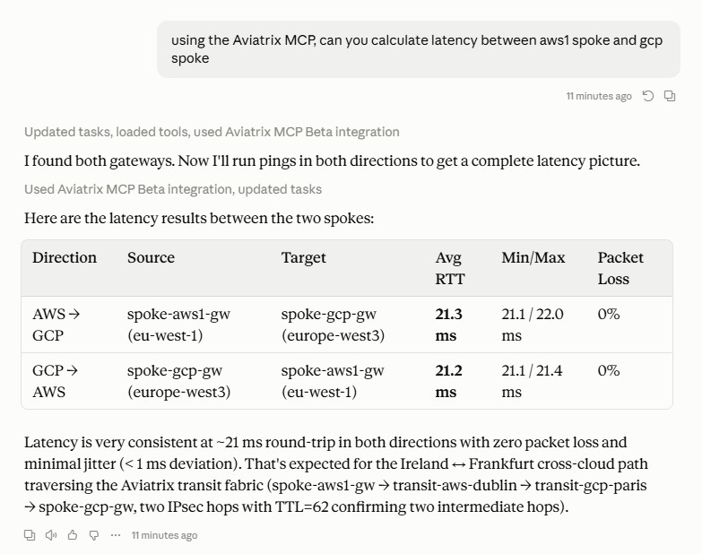
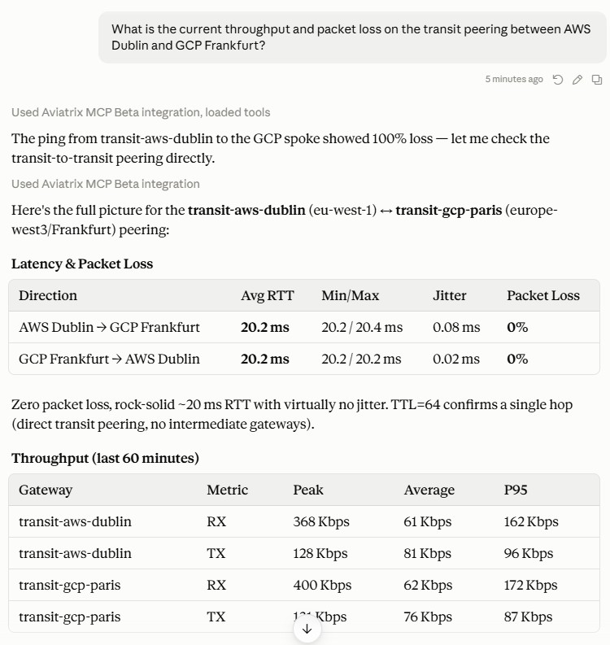
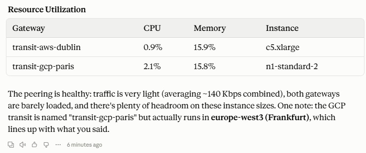
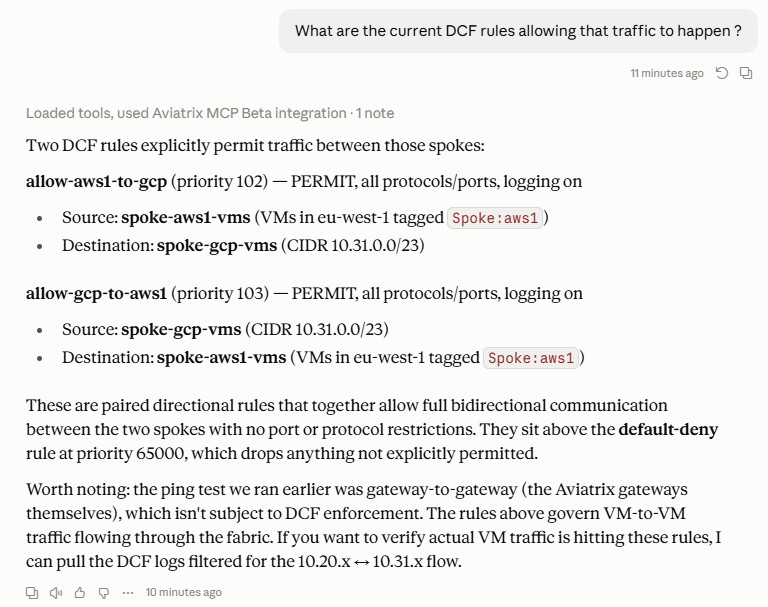

# Aviatrix Multicloud PoC — AWS Dublin + GCP Frankfurt

Terraform proof-of-concept for AL, demonstrating Aviatrix in a multicloud environment: two transit gateways (AWS eu-west-1 and GCP europe-west3) connected over Orange's private underlay, three spoke gateways with workload VMs, DCF east-west segmentation, and ready-to-activate stubs for AWS Direct Connect and GCP Partner Interconnect.

---

## Business Context

AL is evaluating Aviatrix as the multicloud networking layer for workloads split across AWS and GCP, with Orange's private network infrastructure as the underlay between the two clouds.

This PoC demonstrates four capabilities in a single deployable lab:

**Automation** — The entire multicloud network (two cloud providers, two transit gateways, three spokes, peering, DCF policies, test VMs) is deployed from a single `terraform apply`. Infrastructure is version-controlled, repeatable, and self-documenting.

**Visibility** — Aviatrix CoPilot provides a unified topology view spanning both AWS and GCP, flow logs from every gateway, latency metrics between clouds, and a single pane of glass for operations. The Aviatrix MCP server extends this visibility to natural-language queries — ask about latency between spokes, active flows, or DCF hit counts directly from an AI client without touching the CLI.

**Security** — Distributed Cloud Firewall (DCF) enforces east-west segmentation between spoke workloads with smart group tagging (no IP management), default deny, and per-flow logging. All policies are defined in code alongside the infrastructure.

**Encryption** — All data-plane traffic traversing the Aviatrix overlay is encrypted end-to-end with AES-256 / High-Performance Encryption (HPE). The transit peering between AWS Dublin and GCP Frankfurt is fully encrypted regardless of the underlay.

**Private underlay ready** — The AWS Direct Connect Gateway and GCP Partner Interconnect stubs are included in this repo and can be activated with a single variable flip (`deploy_dx_gateway = true`, `deploy_gcp_interconnect = true`) once Orange's circuits toward AL are provisioned. The overlay and DCF policies require no changes.

---

## Table of Contents

- [Architecture](#architecture)
- [Prerequisites](#prerequisites)
- [Quick Start](#quick-start)
- [Variables Reference](#variables-reference)
- [Outputs](#outputs)
- [DCF Policy Detail](#dcf-policy-detail)
- [Activating the Orange Underlay](#activating-the-orange-underlay)
- [Deploy the Controller (optional)](#deploy-the-controller-optional)
- [Teardown](#teardown)
- [Cost Estimate](#cost-estimate-csp-only)
- [Tests](#tests)
- [Aviatrix MCP Server Demo](#aviatrix-mcp-server-demo)
- [Known Gotchas](#known-gotchas)

---

## Architecture

<svg width="940" height="900" viewBox="0 0 940 900" xmlns="http://www.w3.org/2000/svg">
    <defs>
      <marker id="arr" markerWidth="9" markerHeight="6" refX="8" refY="3" orient="auto">
        <polygon points="0 0, 9 3, 0 6" fill="#888"/>
      </marker>
      <marker id="arr-aws" markerWidth="9" markerHeight="6" refX="8" refY="3" orient="auto">
        <polygon points="0 0, 9 3, 0 6" fill="#E07B00"/>
      </marker>
      <marker id="arr-gcp" markerWidth="9" markerHeight="6" refX="8" refY="3" orient="auto">
        <polygon points="0 0, 9 3, 0 6" fill="#1A6DDB"/>
      </marker>
      <marker id="arr-avx" markerWidth="9" markerHeight="6" refX="8" refY="3" orient="auto">
        <polygon points="0 0, 9 3, 0 6" fill="#007FB5"/>
      </marker>
      <marker id="arr-l" markerWidth="9" markerHeight="6" refX="1" refY="3" orient="auto">
        <polygon points="9 0, 0 3, 9 6" fill="#888"/>
      </marker>
      <filter id="shadow" x="-5%" y="-5%" width="110%" height="110%">
        <feDropShadow dx="0" dy="1" stdDeviation="2" flood-opacity=".10"/>
      </filter>
    </defs>

    <!-- ═══════════════════════════════════════════
         AWS Dublin cloud
    ═══════════════════════════════════════════ -->
    <rect x="15" y="15" width="390" height="240" rx="12" fill="#FFF8F0" stroke="#E07B00" stroke-width="2" filter="url(#shadow)"/>
    <!-- cloud badge -->
    <rect x="15" y="15" width="390" height="32" rx="12" fill="#E07B00"/>
    <rect x="15" y="35" width="390" height="12" fill="#E07B00"/>
    <text x="210" y="36" text-anchor="middle" font-size="13" font-weight="700" fill="white">AWS eu-west-1 · Dublin</text>

    <!-- spoke-aws1 -->
    <rect x="35" y="58" width="165" height="54" rx="6" fill="#FFF3E0" stroke="#FFA726" stroke-width="1.2"/>
    <text x="118" y="76" text-anchor="middle" font-size="10" font-weight="700" fill="#E65100">spoke-aws1-gw</text>
    <text x="118" y="91" text-anchor="middle" font-size="10" fill="#BF360C">10.20.0.0/23</text>
    <text x="118" y="105" text-anchor="middle" font-size="9" fill="#999">EC2 · nginx · iperf3</text>

    <!-- spoke-aws2 -->
    <rect x="220" y="58" width="165" height="54" rx="6" fill="#FFF3E0" stroke="#FFA726" stroke-width="1.2"/>
    <text x="302" y="76" text-anchor="middle" font-size="10" font-weight="700" fill="#E65100">spoke-aws2-gw</text>
    <text x="302" y="91" text-anchor="middle" font-size="10" fill="#BF360C">10.21.0.0/23</text>
    <text x="302" y="105" text-anchor="middle" font-size="9" fill="#999">EC2 · nginx · iperf3</text>

    <!-- transit -->
    <rect x="35" y="124" width="350" height="46" rx="7" fill="#FFD39A" stroke="#E07B00" stroke-width="1.5" filter="url(#shadow)"/>
    <text x="210" y="143" text-anchor="middle" font-size="11" font-weight="700" fill="#7A3800">transit-aws-dublin</text>
    <text x="210" y="161" text-anchor="middle" font-size="10" fill="#7A3800">10.10.0.0/23  ·  c5n.xlarge  ·  HPE</text>

    <!-- DX gateway stub -->
    <rect x="35" y="182" width="350" height="54" rx="6" fill="#F1F8E9" stroke="#7CB342" stroke-width="1.2" stroke-dasharray="6,3"/>
    <text x="210" y="201" text-anchor="middle" font-size="10" font-weight="700" fill="#33691E">AWS Direct Connect Gateway  +  VGW</text>
    <text x="210" y="217" text-anchor="middle" font-size="9" fill="#558B2F">VIFs: dxvif-fg7gdkba · dxvif-fgrpf172</text>
    <text x="210" y="231" text-anchor="middle" font-size="9" fill="#777">Orange manages VIF lifecycle via dedicated IAM role</text>

    <!-- ═══════════════════════════════════════════
         GCP Frankfurt cloud
    ═══════════════════════════════════════════ -->
    <rect x="535" y="15" width="390" height="240" rx="12" fill="#EFF4FF" stroke="#1A6DDB" stroke-width="2" filter="url(#shadow)"/>
    <rect x="535" y="15" width="390" height="32" rx="12" fill="#1A6DDB"/>
    <rect x="535" y="35" width="390" height="12" fill="#1A6DDB"/>
    <text x="730" y="36" text-anchor="middle" font-size="13" font-weight="700" fill="white">GCP europe-west3 · Frankfurt</text>

    <!-- spoke-gcp -->
    <rect x="555" y="58" width="350" height="54" rx="6" fill="#E8EAF6" stroke="#5C6BC0" stroke-width="1.2"/>
    <text x="730" y="76" text-anchor="middle" font-size="10" font-weight="700" fill="#283593">spoke-gcp-gw</text>
    <text x="730" y="91" text-anchor="middle" font-size="10" fill="#283593">10.31.0.0/23</text>
    <text x="730" y="105" text-anchor="middle" font-size="9" fill="#999">GCE · nginx · iperf3</text>

    <!-- transit -->
    <rect x="555" y="124" width="350" height="46" rx="7" fill="#AECBFA" stroke="#1A6DDB" stroke-width="1.5" filter="url(#shadow)"/>
    <text x="730" y="143" text-anchor="middle" font-size="11" font-weight="700" fill="#0D47A1">transit-gcp-frankfurt</text>
    <text x="730" y="161" text-anchor="middle" font-size="10" fill="#0D47A1">10.30.0.0/23  ·  n1-highcpu-4  ·  HPE</text>

    <!-- Partner Interconnect stub -->
    <rect x="555" y="182" width="350" height="54" rx="6" fill="#F1F8E9" stroke="#7CB342" stroke-width="1.2" stroke-dasharray="6,3"/>
    <text x="730" y="201" text-anchor="middle" font-size="10" font-weight="700" fill="#33691E">GCP Partner Interconnect  (HA)</text>
    <text x="730" y="217" text-anchor="middle" font-size="9" fill="#558B2F">2× Cloud Routers · ASN 16550 · CUSTOM BGP advert.</text>
    <text x="730" y="231" text-anchor="middle" font-size="9" fill="#777">VLAN att. DOMAIN_1 + DOMAIN_2  ·  europe-west3</text>


    <!-- ═══════════════════════════════════════════
         DX line: AWS → Orange PoP
    ═══════════════════════════════════════════ -->
    <line x1="210" y1="255" x2="348" y2="330" stroke="#E07B00" stroke-width="2.2" marker-end="url(#arr-aws)"/>
    <text x="254" y="286" text-anchor="middle" font-size="9" font-weight="600" fill="#C65D00" transform="rotate(-30,254,286)">AWS Direct Connect</text>

    <!-- ═══════════════════════════════════════════
         IC line: GCP → Orange PoP
    ═══════════════════════════════════════════ -->
    <line x1="730" y1="255" x2="592" y2="330" stroke="#1A6DDB" stroke-width="2.2" marker-end="url(#arr-gcp)"/>
    <text x="686" y="286" text-anchor="middle" font-size="9" font-weight="600" fill="#1A6DDB" transform="rotate(30,686,286)">Partner Interconnect</text>

    <!-- ═══════════════════════════════════════════
         Orange EVP PoP outer box
    ═══════════════════════════════════════════ -->
    <rect x="140" y="295" width="660" height="490" rx="14" fill="#FFF7F2" stroke="#FF6600" stroke-width="2.5" filter="url(#shadow)"/>
    <rect x="140" y="295" width="660" height="34" rx="14" fill="#FF6600"/>
    <rect x="140" y="315" width="660" height="14" fill="#FF6600"/>
    <text x="470" y="318" text-anchor="middle" font-size="14" font-weight="700" fill="white">Orange EVP PoP — Frankfurt</text>

    <!-- Technical VPN 1 -->
    <rect x="168" y="348" width="604" height="88" rx="8" fill="#FFE5CC" stroke="#FF6600" stroke-width="1.5" stroke-dasharray="7,4"/>
    <text x="184" y="368" font-size="10" font-weight="700" fill="#CC4400">Technical VPN 1</text>
    <text x="640" y="368" text-anchor="end" font-size="9" fill="#999">Orange backbone L2/L3 segment</text>
    <!-- VPN1 entries -->
    <rect x="188" y="376" width="256" height="48" rx="5" fill="#FFD39A" stroke="#E07B00" stroke-width="1"/>
    <text x="316" y="394" text-anchor="middle" font-size="10" font-weight="600" fill="#7A3800">Route to transit-aws-dublin</text>
    <text x="316" y="410" text-anchor="middle" font-size="9" fill="#994400">via Direct Connect · VGW</text>
    <text x="316" y="423" text-anchor="middle" font-size="8" fill="#aaa">10.10.0.0/23  +  spoke CIDRs</text>

    <rect x="464" y="376" width="288" height="48" rx="5" fill="#AECBFA" stroke="#1A6DDB" stroke-width="1"/>
    <text x="608" y="394" text-anchor="middle" font-size="10" font-weight="600" fill="#0D47A1">Route to transit-gcp-frankfurt</text>
    <text x="608" y="410" text-anchor="middle" font-size="9" fill="#154FA3">via Partner Interconnect</text>
    <text x="608" y="423" text-anchor="middle" font-size="8" fill="#aaa">10.30.0.0/23  +  spoke CIDRs</text>

    <!-- WAN connector: VPN1 → Edge -->
    <line x1="470" y1="436" x2="470" y2="458" stroke="#007FB5" stroke-width="2" marker-end="url(#arr-avx)"/>
    <rect x="478" y="440" width="100" height="14" rx="3" fill="#FFF7F2"/>
    <text x="480" y="451" font-size="9" font-weight="600" fill="#007FB5">WAN  ·  upstream leg</text>

    <!-- Aviatrix Edge Gateway -->
    <rect x="295" y="460" width="350" height="66" rx="9" fill="#E0F4FF" stroke="#007FB5" stroke-width="2.2" filter="url(#shadow)"/>
    <text x="470" y="482" text-anchor="middle" font-size="13" font-weight="700" fill="#005C87">Aviatrix Edge Gateway</text>
    <text x="470" y="499" text-anchor="middle" font-size="10" fill="#007FB5">Orange EVP PoP  ·  encrypted overlay extension node</text>
    <text x="470" y="515" text-anchor="middle" font-size="9" fill="#888">distributes overlay CIDRs to on-prem via BGP</text>

    <!-- LAN connector: Edge → VPN2 -->
    <line x1="470" y1="526" x2="470" y2="548" stroke="#007FB5" stroke-width="2" marker-end="url(#arr-avx)"/>
    <rect x="478" y="530" width="102" height="14" rx="3" fill="#FFF7F2"/>
    <text x="480" y="541" font-size="9" font-weight="600" fill="#007FB5">LAN  ·  downstream leg</text>

    <!-- Technical VPN 2 -->
    <rect x="168" y="551" width="604" height="214" rx="8" fill="#FFE5CC" stroke="#FF6600" stroke-width="1.5" stroke-dasharray="7,4"/>
    <text x="184" y="571" font-size="10" font-weight="700" fill="#CC4400">Technical VPN 2</text>
    <text x="640" y="571" text-anchor="end" font-size="9" fill="#999">Orange backbone L2/L3 segment</text>

    <!-- SDWAN box -->
    <rect x="258" y="580" width="424" height="170" rx="8" fill="#F1FFF1" stroke="#43A047" stroke-width="2" filter="url(#shadow)"/>
    <text x="470" y="601" text-anchor="middle" font-size="12" font-weight="700" fill="#1B5E20">SDWAN Box</text>

    <!-- BGPoLAN tag -->
    <rect x="318" y="610" width="304" height="26" rx="5" fill="#C8E6C9" stroke="#66BB6A" stroke-width="1.2"/>
    <text x="470" y="628" text-anchor="middle" font-size="10" font-weight="700" fill="#1B5E20">BGPoLAN session  ↔  Edge LAN interface</text>

    <text x="470" y="654" text-anchor="middle" font-size="9" fill="#2E7D32">BGP peering over LAN segment shared with</text>
    <text x="470" y="668" text-anchor="middle" font-size="9" fill="#2E7D32">Aviatrix Edge downstream (LAN) interface</text>
    <text x="470" y="686" text-anchor="middle" font-size="9" fill="#555">SDWAN redistributes overlay CIDRs toward AL DCs</text>
    <text x="470" y="700" text-anchor="middle" font-size="9" fill="#555">via existing SDWAN fabric and on-prem routing</text>
    <text x="470" y="716" text-anchor="middle" font-size="9" fill="#888">AL DCs learn: 10.10/23 · 10.20/23 · 10.21/23 · 10.30/23 · 10.31/23</text>
    <text x="470" y="732" text-anchor="middle" font-size="9" fill="#888">via BGP → SDWAN → site routers</text>

    <!-- connector: Orange PoP → AL DCs -->
    <line x1="470" y1="785" x2="470" y2="808" stroke="#666" stroke-width="2.2" marker-end="url(#arr)"/>

    <!-- AL Data Centers -->
    <rect x="245" y="810" width="450" height="72" rx="10" fill="#F5F5F5" stroke="#757575" stroke-width="2" filter="url(#shadow)"/>
    <text x="470" y="833" text-anchor="middle" font-size="13" font-weight="700" fill="#212121">AL Data Centers  (on-prem)</text>
    <text x="470" y="851" text-anchor="middle" font-size="10" fill="#555">DC Paris  ·  DC Lyon  ·  regional sites</text>
    <text x="470" y="866" text-anchor="middle" font-size="9" fill="#888">connected via SDWAN  →  Orange  →  Aviatrix overlay  →  AWS / GCP</text>

    <!-- ═══════════════════════════════════════════
         Legend
    ═══════════════════════════════════════════ -->
    <rect x="15" y="810" width="210" height="72" rx="8" fill="white" stroke="#ddd" stroke-width="1.2"/>
    <text x="25" y="828" font-size="10" font-weight="700" fill="#333">Legend</text>
    <line x1="25" y1="842" x2="60" y2="842" stroke="#E07B00" stroke-width="2.2"/>
    <text x="66" y="846" font-size="9" fill="#444">AWS Direct Connect</text>
    <line x1="25" y1="856" x2="60" y2="856" stroke="#1A6DDB" stroke-width="2.2"/>
    <text x="66" y="860" font-size="9" fill="#444">GCP Partner Interconnect</text>
    <line x1="25" y1="870" x2="60" y2="870" stroke="#9E9E9E" stroke-width="1.8" stroke-dasharray="6,3"/>
    <text x="66" y="874" font-size="9" fill="#444">Encrypted overlay (AES-256 HPE)</text>

    <!-- DCF note -->
    <rect x="715" y="810" width="210" height="72" rx="8" fill="white" stroke="#ddd" stroke-width="1.2"/>
    <text x="725" y="828" font-size="10" font-weight="700" fill="#333">DCF smart groups</text>
    <text x="725" y="843" font-size="9" fill="#444">spoke-aws1-vms  ·  10.20/23</text>
    <text x="725" y="857" font-size="9" fill="#444">spoke-aws2-vms  ·  10.21/23</text>
    <text x="725" y="871" font-size="9" fill="#444">spoke-gcp-vms  ·  10.31/23</text>
    <text x="725" y="876" font-size="9" fill="#888">default DENY  ·  east-west PERMIT</text>
  </svg>

| | |
|---|---|
| **DCF smart groups** | `spoke-aws1-vms` · `spoke-aws2-vms` · `spoke-gcp-vms` · `eks-pods` (optional) |
| **East-west policy** | PERMIT all spokes ↔ all spokes · default DENY |
| **Egress policy** | PERMIT TCP 80/443 from spoke VMs via gateway (`single_ip_snat`) |
| **VPN clients** | PERMIT → Anywhere (when `deploy_vpn = true`) |


### Two Terraform roots

| Root            | Purpose                                                                                         |
| --------------- | ----------------------------------------------------------------------------------------------- |
| `controlplane/` | Deploy Aviatrix Controller + CoPilot on AWS (one-time, skip if a Controller is already running) |
| `.` (repo root) | Deploy the multicloud network against an existing Controller                                    |

[↑ Back to top](#table-of-contents)

---

## Prerequisites

### AI assistant

An AI assistant (Claude or equivalent) is **strongly recommended** to get the full value of this PoC — particularly for the [Aviatrix MCP Server](#aviatrix-mcp-server-demo) demo, natural-language visibility queries, and assisted troubleshooting. The AI assistant must be supplied by AL as part of their tooling.

### AL tenant accounts

Two cloud accounts from AL's tenant are required before deploying anything.

#### AWS account (`eu-west-1`)

IAM credentials (access key + secret) with permissions to create VPCs, EC2 instances, key pairs, security groups, and EIPs. The account must have enough quota for the resources below — check limits in **Service Quotas → EC2** before applying.

**Aviatrix IAM roles** — Aviatrix requires two IAM roles (`aviatrix-role-ec2` and `aviatrix-role-app`) in the AWS account to allow the Controller to manage resources. Two options:

- **Automatic** — if `create_iam_roles = true` in `controlplane/terraform.tfvars` (default), the controlplane module creates the roles automatically during Controller deployment.
- **Manual** — if the roles already exist or need to be pre-created by AL's cloud team, follow the Aviatrix documentation: [IAM role setup](https://docs.aviatrix.com/docs/enterprise/9.0/reference/general/iam-role#notes-for-the-custom-iam-role-name-feature). Set `create_iam_roles = false` in `controlplane/terraform.tfvars` to skip automatic creation.

| Resource                | Consumed | Default limit | Notes                                                                                                                                                                                                 |
| ----------------------- | -------- | ------------- | ----------------------------------------------------------------------------------------------------------------------------------------------------------------------------------------------------- |
| Elastic IPs (EIPs)      | **3–4**  | 5 per region  | 1× transit gateway + 2× spoke gateways. Optional EKS adds 1 NAT GW EIP. If the Controller and CoPilot also run in this account, they consume 2 more EIPs — total 5–6. Request a quota increase to 10. |
| VPCs                    | **4–5**  | 5 per region  | 1× transit VPC + 2× spoke VPCs + 1× controlplane VPC (if Controller deployed here) + 1× EKS VPC (if `deploy_eks = true`). Request increase to 10 if needed.                                           |
| EC2 instances (running) | **5+**   | varies        | 1× transit gateway (`c5.xlarge`) + 2× spoke gateways (`t3.small`) + 2× spoke VMs (`t3.micro`) + EKS node group (2× `t3.medium`) if enabled. Controlplane adds 2 more if deployed here.                |
| Internet Gateways       | **4–5**  | 5 per region  | 1 per VPC. EKS adds 1 more. Request increase if near limit.                                                                                                                                           |
| Security Groups         | ~10      | 2500          | No concern in practice.                                                                                                                                                                               |

> **EIP and VPC limits are the most common deployment blockers.** Run `aws ec2 describe-addresses --region eu-west-1` and `aws ec2 describe-vpcs --region eu-west-1` to count before applying. If `deploy_eks = true`, you need headroom for 1 additional VPC and 1 additional EIP. Request increases via:
> ```bash
> aws service-quotas request-service-quota-increase --service-code vpc --quota-code L-F678F1CE --desired-value 10 --region eu-west-1
> aws service-quotas request-service-quota-increase --service-code ec2 --quota-code L-0263D0A3 --desired-value 10 --region eu-west-1
> ```

#### GCP project (`europe-west3`)

A GCP project in AL's organization with the **Compute Engine API** enabled.

**GCP service account** — Aviatrix requires a dedicated GCP service account with specific IAM roles to manage resources in the project. Two options:

- **Recommended (restricted)** — follow the Aviatrix documentation to create a service account with least-privilege access: [GCP account onboarding with restricted access](https://docs.aviatrix.com/docs/enterprise/9.0/guides/platform-administration/gcp-account-onboarding#create-a-service-account-with-restricted-access). Download the JSON key and set `GOOGLE_APPLICATION_CREDENTIALS=/path/to/key.json` before running Terraform.
- **Broad access** — grant `Compute Admin` and `Service Account User` roles. Faster for a PoC but not recommended for production accounts.

The service account must then be onboarded into the Aviatrix Controller (Controller → Onboarding → GCP) using the JSON key before running `terraform apply`.

| Resource                | Consumed | Default limit | Notes                                                                                                                                                                     |
| ----------------------- | -------- | ------------- | ------------------------------------------------------------------------------------------------------------------------------------------------------------------------- |
| CPUs (N1, europe-west3) | **6**    | 24            | 1× transit gateway (`n1-standard-2` = 2 vCPU) + 1× spoke gateway (`n1-standard-2` = 2 vCPU) + 1× spoke VM (`e2-micro` = 0.25 vCPU, rounds up). Well within default quota. |
| VPC networks            | **2**    | 15            | 1× transit VPC + 1× spoke VPC.                                                                                                                                            |
| Static external IPs     | **2**    | 8             | 1 per Aviatrix gateway.                                                                                                                                                   |
| Firewall rules          | ~8       | 200           | Aviatrix creates `avx-*` rules automatically per VPC.                                                                                                                     |

Both accounts must be onboarded into the Aviatrix Controller before running `terraform apply`.

---

### Toolchain

```bash
terraform version   # >= 1.3.0
aws --version
gcloud --version
```

Install links: [Terraform](https://developer.hashicorp.com/terraform/install) · [AWS CLI](https://docs.aws.amazon.com/cli/latest/userguide/getting-started-install.html) · [gcloud SDK](https://cloud.google.com/sdk/docs/install)

### AWS credentials

```bash
aws sts get-caller-identity
```

Must succeed for the account hosting the PoC gateways.

### GCP credentials

```bash
gcloud auth application-default login
gcloud config set project <PROJECT_ID>
gcloud config get project   # confirm
```

### Aviatrix Controller

Either deploy one via `controlplane/` (see [Deploy the Controller](#deploy-the-controller-optional)) or point at an existing Controller. You need:

- Controller IP or hostname
- Admin password
- Name of the AWS account onboarded in the Controller (Controller > Accounts > AWS)
- Name of the GCP account onboarded in the Controller (Controller > Accounts > GCP)

[↑ Back to top](#table-of-contents)

---

## Quick Start

### 1. Clone and configure

```bash
git clone <this-repo>
cd avx-poc-0
cp terraform.tfvars.example terraform.tfvars
```

Edit `terraform.tfvars` — minimum required:

```hcl
aviatrix_controller_ip = "<controller-ip-or-hostname>"
aviatrix_password      = "<admin-password>"
aws_account_name       = "<aws-account-name-in-controller>"
gcp_account_name       = "<gcp-account-name-in-controller>"
gcp_project_id         = "<gcp-project-id>"
```

### 2. Deploy

```bash
terraform init
terraform plan
terraform apply
```

Deployment takes approximately 20–30 minutes. Gateway provisioning is the bottleneck.

### 3. Verify

Run the full automated test suite from a host with private network access to the spoke subnets:

```bash
AVX_PASSWORD=<controller-admin-password> ./tests.sh
```

Or check individual nginx pages:

```bash
terraform output nginx_url_aws1
terraform output nginx_url_aws2
terraform output nginx_url_gcp
```

Each page confirms the VM's cloud and region. SSH commands (private IP, key at `spoke-vms.pem`) are in the outputs.

[↑ Back to top](#table-of-contents)

---

## Variables Reference

### Required

| Variable                 | Description                           |
| ------------------------ | ------------------------------------- |
| `aviatrix_controller_ip` | Controller hostname or IP             |
| `aviatrix_password`      | Controller admin password (sensitive) |
| `aws_account_name`       | Aviatrix-onboarded AWS account name   |
| `gcp_account_name`       | Aviatrix-onboarded GCP account name   |
| `gcp_project_id`         | GCP project ID (not display name)     |

### Optional — network

| Variable           | Default        | Description            |
| ------------------ | -------------- | ---------------------- |
| `aws_region`       | `eu-west-1`    | AWS region (Dublin)    |
| `gcp_region`       | `europe-west3` | GCP region (Frankfurt) |
| `transit_aws_cidr` | `10.10.0.0/23` | AWS transit VPC CIDR   |
| `transit_gcp_cidr` | `10.30.0.0/23` | GCP transit VPC CIDR   |
| `spoke_aws1_cidr`  | `10.20.0.0/23` | AWS spoke 1 VPC CIDR   |
| `spoke_aws2_cidr`  | `10.21.0.0/23` | AWS spoke 2 VPC CIDR   |
| `spoke_gcp_cidr`   | `10.31.0.0/23` | GCP spoke VPC CIDR     |

### Optional — gateway sizing

| Variable                 | Default         | Description                       |
| ------------------------ | --------------- | --------------------------------- |
| `transit_aws_gw_size`    | `c5.xlarge`     | AWS transit gateway instance size |
| `transit_gcp_gw_size`    | `n1-standard-2` | GCP transit gateway instance size |
| `spoke_aws_gw_size`      | `t3.small`      | AWS spoke gateway instance size   |
| `spoke_gcp_gw_size`      | `n1-standard-2` | GCP spoke gateway instance size   |
| `spoke_vm_instance_type` | `t3.micro`      | EC2 instance type for spoke VMs   |
| `spoke_gcp_vm_type`      | `e2-micro`      | GCP instance type for spoke VM    |

### Optional — EKS (Elastic Kubernetes Service) with Gatus dashboards

| Variable                 | Default        | Description                                                 |
| ------------------------ | -------------- | ----------------------------------------------------------- |
| `deploy_eks`             | `false`        | Deploy EKS cluster with Gatus apps and k8s DCF smart groups |
| `eks_cidr`               | `10.22.0.0/23` | CIDR for the EKS VPC                                        |
| `eks_node_instance_type` | `t3.medium`    | EC2 instance type for EKS managed nodes                     |

When `deploy_eks = true`, Terraform deploys:
- EKS cluster v1.32 in a dedicated VPC (10.22.0.0/23) with **VPC CNI** — each pod gets a real VPC IP, visible to Aviatrix as a network entity
- Managed node group (2× `t3.medium`, private subnets) with NAT gateway for egress
- Aviatrix spoke gateway in the EKS VPC, attached to the AWS transit
- Two Gatus deployments: `gatus-aviatrix` (monitors `https://aviatrix.ai`) and `gatus-example` (monitors `https://www.example.com`), each in its own namespace
- Two k8s-type Aviatrix smart groups matched by cluster + namespace
- Two webgroups for domain-based SNI filtering (`aviatrix.ai`, `example.com`)
- DCF policy 210: **DENY** `gatus-aviatrix` → `aviatrix.ai` webgroup (demonstrates domain-level blocking)
- DCF policy 211: **PERMIT** `gatus-example` → `example.com` webgroup (conditional on `allow_example_com_egress`; set `false` to demonstrate default-deny)

**AWS quota requirements for EKS:** 1 additional VPC (total 5+) and 1 additional EIP (NAT gateway) beyond the base deployment. See the quota commands in the AWS quota table above.

### Optional — private underlay stubs

| Variable                       | Default          | Description                                               |
| ------------------------------ | ---------------- | --------------------------------------------------------- |
| `deploy_dx_gateway`            | `false`          | Deploy AWS Direct Connect Gateway attached to AWS transit |
| `dx_gateway_asn`               | `64512`          | BGP ASN for the DX Gateway                                |
| `dx_gateway_name`              | `poc-dx-gateway` | DX Gateway name                                           |
| `deploy_gcp_interconnect`      | `false`          | Deploy GCP Partner Interconnect VLAN attachments          |
| `gcp_interconnect_router_asn`  | `65000`          | BGP ASN for the GCP Cloud Router                          |
| `gcp_interconnect_bandwidth`   | `BPS_1G`         | Bandwidth for VLAN attachment                             |
| `gcp_interconnect_pairing_key` | `""`             | Pairing key from partner (leave empty on first apply)     |

[↑ Back to top](#table-of-contents)

---

## Outputs

| Output                         | Description                                                                      |
| ------------------------------ | -------------------------------------------------------------------------------- |
| `ssh_connect_aws1`             | Ready SSH command for AWS spoke 1 VM (requires VPN — private IP)                |
| `ssh_connect_aws2`             | Ready SSH command for AWS spoke 2 VM (requires VPN — private IP)                |
| `ssh_connect_gcp`              | Ready SSH command for GCP spoke VM (requires VPN — private IP)                  |
| `nginx_url_aws1`               | HTTP URL for AWS spoke 1 nginx page (requires VPN)                              |
| `nginx_url_aws2`               | HTTP URL for AWS spoke 2 nginx page (requires VPN)                              |
| `nginx_url_gcp`                | HTTP URL for GCP spoke nginx page (requires VPN)                                |
| `ssh_private_key_path`         | Path to generated `spoke-vms.pem` (chmod 600, gitignored)                       |
| `aviatrix_controller_ip`       | Controller IP — used by `tests.sh` to call the API                              |
| `vpn_gateway_ip`               | VPN gateway public IP — use as server address in OpenVPN client (if `deploy_vpn = true`) |
| `dx_gateway_id`                | AWS Direct Connect Gateway ID (if deployed)                                     |
| `gcp_interconnect_pairing_key` | GCP Partner Interconnect pairing key to give to Orange (if deployed)            |
| `eks_cluster_endpoint`         | EKS cluster API endpoint (if `deploy_eks = true`)                               |
| `eks_kubeconfig_cmd`           | `aws eks update-kubeconfig` command to configure kubectl                         |
| `gatus_aviatrix_url`           | Gatus aviatrix.ai dashboard pod URL — accessible via VPN + kubectl (if EKS)     |
| `gatus_example_url`            | Gatus example.com dashboard pod URL — accessible via VPN + kubectl (if EKS)     |

[↑ Back to top](#table-of-contents)

---

## DCF Policy Detail

Distributed Cloud Firewall is enabled at the controller level and enforced at each spoke gateway. Smart groups use VM tags (AWS) and CIDR (GCP) to identify workloads — no manual IP management.

| Priority | Rule                                                                          | When         | Action        |
| -------- | ----------------------------------------------------------------------------- | ------------ | ------------- |
| 50       | VPN clients → Anywhere (ANY)                                                  | deploy_vpn   | PERMIT        |
| 60       | EKS nodes → Public Internet (ANY)                                             | deploy_eks   | PERMIT        |
| 70       | spoke-aws1 + spoke-aws2 VMs → Public Internet (TCP 80, 443)                  | always       | PERMIT        |
| 71       | spoke-gcp VMs → Public Internet (TCP 80, 443)                                | deploy_gcp   | PERMIT        |
| 100      | spoke-aws1 → spoke-aws2                                                       | always       | PERMIT ANY    |
| 101      | spoke-aws2 → spoke-aws1                                                       | always       | PERMIT ANY    |
| 102–105  | spoke-aws1/aws2 ↔ spoke-gcp (all pairs)                                       | deploy_gcp   | PERMIT ANY    |
| 210      | gatus-aviatrix pods → Public Internet via `aviatrix.ai` webgroup (TCP 443)   | deploy_eks   | DENY (logged) |
| 211      | gatus-example pods → Public Internet via `example.com` webgroup (TCP 443)    | deploy_eks + allow_example_com_egress | PERMIT |
| 65000    | Anywhere → Anywhere                                                           | always       | DENY (logged) |

All rules log matched flows. Flow logs visible in CoPilot > Security > Distributed Cloud Firewall > Monitor.

> Priority 210 is a **DENY** for `gatus-aviatrix` pods — intentional demo of domain-level blocking. Priority 211 is a **PERMIT** for `gatus-example` pods, toggled by `allow_example_com_egress = false` to demonstrate default-deny blocking.

[↑ Back to top](#table-of-contents)

---

## Activating the Orange Underlay

When Orange's circuits are available, activate the private underlay stubs without touching the overlay or DCF configuration:

### AWS Direct Connect

```hcl
# terraform.tfvars
deploy_dx_gateway = true
dx_gateway_asn    = 64512       # optional — match Orange's BGP config
dx_gateway_name   = "poc-dx-gw" # optional
```

This creates an `aws_dx_gateway` with a Virtual Gateway (VGW) association on the AWS transit VPC. Order the DX Connection and Private VIF separately via AWS Console or through Orange as the connectivity partner.

### GCP Partner Interconnect

Two-step process (pairing key must be exchanged with Orange):

**Step 1** — Create the VLAN attachment to obtain the pairing key:

```hcl
# terraform.tfvars
deploy_gcp_interconnect      = true
gcp_interconnect_pairing_key = ""   # leave empty
```

```bash
terraform apply
terraform output gcp_interconnect_pairing_key
```

**Step 2** — Give the pairing key to Orange, then complete the attachment:

```hcl
# terraform.tfvars
gcp_interconnect_pairing_key = "<key-from-step-1>"
```

```bash
terraform apply
```

The attachment transitions from `PENDING_CUSTOMER` to `ACTIVE` once Orange provisions their side of the circuit.

[↑ Back to top](#table-of-contents)

---

## Deploy the Controller (optional)

Skip this section if an Aviatrix Controller is already running. Use the existing Controller's IP and password directly in `terraform.tfvars`.

If you need to deploy a fresh Controller:

```bash
cd controlplane
cp terraform.tfvars.example terraform.tfvars
# edit terraform.tfvars — see below for required values
terraform init
terraform apply
```

Required values for `controlplane/terraform.tfvars`:

| Variable                    | Description                                                                          |
| --------------------------- | ------------------------------------------------------------------------------------ |
| `controller_admin_email`    | Admin email for the Controller                                                       |
| `controller_admin_password` | Admin password (sensitive)                                                           |
| `customer_id`               | Aviatrix license ID (`xxxxxxx-abu-xxxxxxxxx`)                                        |
| `access_account_name`       | Name to give the AWS account inside the Controller                                   |
| `account_email`             | Email for the AWS access account                                                     |
| `incoming_ssl_cidrs`        | Your public IP in CIDR form (`curl -s https://checkip.amazonaws.com` → append `/32`) |

After apply, note the outputs:
- `controller_public_ip` → use as `aviatrix_controller_ip` in root `terraform.tfvars`
- `access_account_name` → use as `aws_account_name`
- `controller_url` / `copilot_url` → browser access

Wait ~5 minutes for Controller bootstrap to complete before running the root module.

[↑ Back to top](#table-of-contents)

---

## Teardown

Destroy the root module first, then the Controller if it was deployed here:

```bash
# From repo root
terraform destroy

# Only if you want to tear down the Controller too
cd controlplane
terraform destroy
```

Remove the generated SSH key:

```bash
rm spoke-vms.pem
```

[↑ Back to top](#table-of-contents)

---

## Cost Estimate (CSP only)

> **Aviatrix licensing:** Aviatrix offers a 30-day free trial — license costs are waived for the trial period. Only CSP infrastructure costs apply during a PoC.

These are **cloud provider infrastructure costs only**. All figures are approximate, based on on-demand pricing in `eu-west-1` (AWS) and `europe-west3` (GCP) as of mid-2025. Costs scale linearly with uptime.

### AWS (`eu-west-1`)

| Resource                        | Type        | Billing model    | Monthly cost (est.) |
| ------------------------------- | ----------- | ---------------- | ------------------- |
| Transit gateway EC2             | `c5.xlarge` | $0.192/hr × 730  | **~$140/month**     |
| Spoke gateway 1 EC2             | `t3.small`  | $0.023/hr × 730  | **~$17/month**      |
| Spoke gateway 2 EC2             | `t3.small`  | $0.023/hr × 730  | **~$17/month**      |
| Spoke VM 1 EC2                  | `t3.micro`  | $0.012/hr × 730  | **~$9/month**       |
| Spoke VM 2 EC2                  | `t3.micro`  | $0.012/hr × 730  | **~$9/month**       |
| EIPs (2× spoke gw + 1× transit) | —           | No charge in use | $0                  |
| **AWS subtotal**                |             |                  | **~$192/month**     |

> Spoke VMs have **private IPs only** (`associate_public_ip_address = false`). No EIP cost for workloads. Internet egress goes via the Aviatrix spoke gateway's EIP (`single_ip_snat = true`).

### GCP (`europe-west3`)

| Resource                        | Type            | Billing model    | Monthly cost (est.) |
| ------------------------------- | --------------- | ---------------- | ------------------- |
| Transit gateway VM              | `n1-standard-2` | $0.112/hr × 730  | **~$82/month**      |
| Spoke gateway VM                | `n1-standard-2` | $0.112/hr × 730  | **~$82/month**      |
| Spoke VM                        | `e2-micro`      | $0.008/hr × 730  | **~$6/month**       |
| Static external IPs (2× gw EIP) | —               | $0.005/IP/hr × 2 | **~$7/month**       |
| **GCP subtotal**                |                 |                  | **~$177/month**     |

> Spoke VM has **no external IP** (`access_config {}` removed). No ephemeral IP charge for the workload instance (~$0.004/hr saved vs. a public-IP design). Internet egress flows via the Aviatrix spoke gateway's static external IP.

### Summary

| Component                                           | Monthly cost (est.) |
| --------------------------------------------------- | ------------------- |
| AWS compute (transit + 2× spokes + 2× VMs)          | ~$192               |
| GCP compute (transit + spoke + VM)                  | ~$177               |
| AWS Direct Connect — 50 Mbps hosted (Orange Paris)  | ~$22                |
| GCP Partner Interconnect — 50 Mbps VLAN + router    | ~$47                |
| **Total CSP**                                       | **~$438/month**     |

DX: $0.03/hr × 730 hrs (AWS port charge — same rate regardless of partner facility). DX Gateway and VGW no charge. Orange charges the local circuit fee separately. Data transfer out $0.02/GB (usage-based).

GCP IC: $0.05417/hr × 730 hrs VLAN + $0.01/hr Cloud Router. Partner capacity (Orange) billed separately. Egress $0.02/GB (usage-based).

> **Disclaimer:** All pricing figures in this section are provided for informational purposes only and were computed by AI. They may not reflect current list prices, regional variations, or negotiated rates. Always verify against official AWS, GCP, and partner pricing pages before making financial decisions.

> Compute estimate assumes 24/7 operation for 30 days. Orange's circuit charges (DX hosted connection + Partner Interconnect capacity) are not included — these are negotiated directly between Orange and AL.

> **Tip — stop instead of destroy:** Aviatrix gateways are EC2/GCE instances. Stopping them overnight via the Controller halts compute billing while preserving configuration. EIPs and static IPs continue to accrue a small idle charge (~$0.005/hr per IP) unless released. GCP VLAN attachment billing continues even when gateways are stopped.

> **Data transfer:** Cross-cloud egress (AWS → internet toward GCP) is billed by AWS at ~$0.09/GB. For a PoC with light test traffic this is negligible (<$1 total). With private underlay active, egress over the circuit drops to ~$0.02/GB.

[↑ Back to top](#table-of-contents)

---

## Tests

`tests.sh` runs an automated connectivity and policy validation suite. All spoke VMs have private IPs only — the script must run from a host that can reach the spoke private CIDRs. This means either **an active Aviatrix User VPN connection** or **a test station already part of the private network** (jump host, bastion, or any machine with routed access to the spoke subnets).

### Prerequisites

1. **Network access to spoke private CIDRs** — skip this step if the test station already has routed access to the spoke subnets (jump host, bastion, or machine on the private network). Otherwise, connect via Aviatrix User VPN: import the `.ovpn` profile from the Controller into any OpenVPN-compatible client and connect to `vpn_gateway_ip` (from `terraform output`).

2. **Set controller password** — the script needs it to call the controller API:

```bash
export AVX_PASSWORD=<controller-admin-password>
```

> Never hardcode the password in the script or commit it to version control.

### Running

```bash
# Default — IPs and controller address are read automatically from terraform output
AVX_PASSWORD=<password> ./tests.sh
```

The script resolves all spoke IPs and the controller address from `terraform output` at runtime, so it stays in sync with the deployed state without manual edits.

**Override any value via environment variable** (useful when running outside the repo root or against a different deployment):

```bash
AWS1_PRIV=10.20.0.43 \
AWS2_PRIV=10.21.0.58 \
GCP_PRIV=10.31.0.3 \
CONTROLLER=98.66.161.244 \
KEY=spoke-vms.pem \
AVX_PASSWORD=<password> \
./tests.sh
```

| Variable | Default source | Description |
|---|---|---|
| `AVX_PASSWORD` | — required — | Controller admin password |
| `AWS1_PRIV` | `terraform output nginx_url_aws1` | AWS Spoke 1 private IP |
| `AWS2_PRIV` | `terraform output nginx_url_aws2` | AWS Spoke 2 private IP |
| `GCP_PRIV` | `terraform output nginx_url_gcp` | GCP Spoke private IP |
| `CONTROLLER` | `terraform output aviatrix_controller_ip` | Controller IP or hostname |
| `KEY` | `spoke-vms.pem` | SSH private key path |

### What each test does

**Test 1 (section 1) — East-west same cloud (AWS1 → AWS2)**
SSH into AWS Spoke 1 and curl AWS Spoke 2's private IP. Traffic flows through the Aviatrix overlay (spoke → transit → spoke) entirely within AWS. Confirms intra-cloud transit routing and the DCF PERMIT policy.

**Test 2 (section 2) — Cross-cloud east-west (AWS1 → GCP)**
SSH into AWS Spoke 1 and curl the GCP spoke's private IP. Traffic crosses the encrypted Aviatrix transit peering between Dublin and Frankfurt. Confirms cross-cloud routing and DCF policy.

**Test 3 (section 3) — Cross-cloud latency (ICMP RTT)**
Runs `ping -c 5` from AWS Spoke 1 to the GCP spoke and captures RTT statistics. Provides a latency baseline (~22 ms Dublin → Frankfurt over internet overlay).

**Test 4 (section 4) — Egress via Aviatrix spoke gateway**
SSH into each spoke VM and curl `http://example.com`. Verifies the DCF egress PERMIT policy (TCP 80/443) is active and `single_ip_snat` on the spoke gateway is forwarding internet-bound traffic correctly. Tests both AWS and GCP spokes.

**Test 5 (section 5) — Traceroute AWS → GCP**
Runs `tracepath` from AWS Spoke 1 toward the GCP spoke. The first hop (Aviatrix gateway) replies; subsequent hops show no-reply because traffic is inside the encrypted tunnel. This is expected and confirms the overlay is active.

### Test checklist

| #  | Pass  | Test                                        | What it proves                                       |
|----|:-----:|---------------------------------------------|------------------------------------------------------|
| 1  |  [ ]  | AWS Spoke 1 → AWS Spoke 2 (private IP)      | East-west same cloud, DCF PERMIT active              |
| 2  |  [ ]  | AWS Spoke 1 → GCP (private IP)              | Cross-cloud transit peering                          |
| 3  |  [ ]  | Cross-cloud ICMP RTT                        | Latency baseline (~22 ms Dublin ↔ Frankfurt)         |
| 4  |  [ ]  | HTTP egress — AWS Spoke 1                   | single_ip_snat + DCF egress PERMIT working           |
| 5  |  [ ]  | HTTP egress — GCP Spoke                     | single_ip_snat + DCF egress PERMIT working           |
| 5  |  [ ]  | Traceroute AWS → GCP                        | Gateway hop visible, tunnel hops no-reply (expected) |

Expected: **5 passed, 0 failed** (traceroute is informational, no pass/fail counted).

No-reply hops in traceroute are intentional — traffic is encapsulated in the Aviatrix encrypted tunnel after the first gateway hop.

[↑ Back to top](#table-of-contents)

---

## Aviatrix MCP Server Demo

The Aviatrix MCP server exposes Aviatrix controller and CoPilot capabilities as tools that any MCP-compatible AI client (Claude Desktop, Claude Code, Cursor, etc.) can call, enabling natural-language network operations against a live multicloud environment.

**Access:** https://platform-login.mcp.aviatrix.com/

### Demo prompts

Connect the MCP server to an AI client, then try the prompts below against the deployed PoC.

#### Observability — latency and topology

```
Using the Aviatrix MCP, can you calculate the latency between the aws1 spoke gateway and the gcp spoke gateway?
```



```
Show me the full network topology for this multicloud environment. Which gateways are peered and what are their CIDRs?
```

```
What is the current throughput and packet loss on the transit peering between AWS Dublin and GCP Frankfurt?
```




#### Security — DCF policy inspection

```
What are the current DCF rules allowing traffic between the aws1 spoke and the gcp spoke?
```



```
List all DENY rules currently active in the Distributed Cloud Firewall and explain what traffic they block.
```

```
Which smart groups are defined, and which DCF policies reference them?
```

```
Is there any DCF rule that would block ICMP between spoke-aws1-vms and spoke-gcp-vms?
```

#### Encryption — tunnel status

```
Are all transit tunnels between AWS Dublin and GCP Frankfurt currently encrypted? What encryption algorithm is in use?
```

```
List all active encrypted tunnels on the AWS transit gateway and their current state.
```

### What this demonstrates

| Query theme | Aviatrix capability shown |
|---|---|
| Latency / RTT calculation | CoPilot FlowIQ, gateway-to-gateway telemetry |
| Topology discovery | Controller API — VPCs, gateways, peerings |
| DCF policy listing | Distributed Cloud Firewall policy engine |
| Smart group inspection | Tag-based workload identity, no IP management |
| Tunnel encryption status | HPE (High-Performance Encryption) visibility |

[↑ Back to top](#table-of-contents)

---

## Known Gotchas

- `aviatrix_distributed_firewalling_config` is controller-global — only one instance per controller. If DCF is already enabled on this controller by another workspace, import the resource before applying: `terraform import aviatrix_distributed_firewalling_config.this distributed_firewalling_config`
- **AWS spoke VPCs**: `subnets[0]` is the Aviatrix gateway subnet; spoke VMs use `subnets[1]` (private workload subnet)
- **GCP spoke VPCs**: only `subnets[0]` exists — both the Aviatrix gateway and the workload VM use it. There is no `subnets[1]`.
- GCP `google_compute_interconnect_attachment` with `type = "PARTNER"` and an empty `pairing_key` is valid on first create — the attachment enters `PENDING_CUSTOMER` state awaiting the partner
- After `controlplane/` apply, wait ~5 minutes for Controller bootstrap before running the root module

[↑ Back to top](#table-of-contents)
